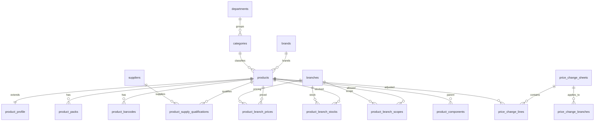

# 科迈云帆商品档案：采集与数据库设计分析

调研日期：2026-11-06。以下结论来自当前账号可见的商品档案、详情、编辑页及“档案”菜单。只读查看；本次没有修改 SaaS 或数据库。采样商品主档与详情响应见 `kemai_product_detail_sample_211836_2026-11-06.json`；非空的组合商品父子关系样本见 `kemai_combination_sample_209517_2026-11-06.json`。

## 观察到的数据结构

商品档案列表当前共 18,383 条，默认每页 100 条。第一页 CSV 有 26 个命名列；列表接口 `/web/api/product/item/getListData` 的单条响应约有 140 个字段。右侧“编辑”进入商品主档表单，`/web/api/product/item/doLoadEntity` 在所采商品上返回 157 个主档字段，并有 8 个可见页签：基础资料、副条码、多包装、等级商品、辅助信息、经营群组、生鲜采配、商品做法。当前账号的自定义属性、销售码页签隐藏；不能据此认为其他账号或商品没有这些数据。

列表下方还有独立的 14 个详情页签。所采普通商品的返回如下；`0` 仅表示此商品当前为空。

| 详情页签 | 实际接口或内容 | 本次返回 | 建议粒度 |
| --- | --- | ---: | --- |
| 供货资格 | `product/price/purchasePrice` | 1 | 商品 × 机构 × 供应商 × 单位 |
| 门店售价 | `product/price/retailPrice` | 1 | 商品 × 机构 × 包装/单位 |
| 门店配送价 | `product/price/deliveryPrice` | 1 | 商品 × 机构 × 包装/单位 |
| 多包装 | `product/pack/queryItemPack` | 0 | 商品的一对多包装 |
| 副条码 | `product/barcode/attach` | 0 | 商品的一对多条码 |
| 等级商品 | `product/pack/freshGrading` | 0 | 商品的一对多等级 |
| 历史进价 | `product/queryItemHistoryReceivePrice` | 空 | 收货单明细/进价事件 |
| 促销信息 | `product/item/promote` | 0 | 活动 × 商品 × 机构 |
| 库存信息 | `product/itemStock/query` | 1 | 商品 × 机构的当前库存 |
| 经营范围 | `product/item/queryMustInBusinessScope` | 1 | 商品 × 机构的经营许可和生命周期 |
| 组合商品 | 对应组合关系管理 | 空 | 父商品 × 子商品 |
| 混售商品 | 对应混售商品管理 | 空 | 父商品 × 子商品 |
| 拆分商品 | `item/relation/splitDetails`, `type=5` | 空 | 父商品 × 子商品 |
| 分割商品 | `item/relation/splitDetails`, `type=2` | 空 | 父商品 × 子商品 |

编辑页的“辅助信息”还有税率、季节、课组、最小订货量、尺寸/重量、保质期、图片、审批和修改记录等单值字段；“经营群组”是多值关联。主档响应包含 `itemClsId`、`itemBrandId`、`itemDepartmentId`、`supplierId`、`unitId`、`purchaseUnitId`、`deliveryUnitId`、`wholesaleUnitId`、`sectionId` 等源系统 ID，足以建立明确的主数据关联。编辑页还分别请求商品群组、商品做法、销售码与自定义属性数据。

“档案”菜单抽查到的独立主数据接口与关系：

| 菜单 | 已确认的接口/字段 | 关系判断 |
| --- | --- | --- |
| 机构档案 | `user/branch/getListData`，`id/pid/code/type` | 机构有父子层级；价格、库存、经营范围按机构关联 |
| 部门档案 | `product/department/getListData`，`id/code/name/firstCategories` | 商品和类别关联部门 |
| 类别管理 | `product/category/getListData`，`id/parentId/departmentId/level`；当前 801 类 | 类别树，商品指向末级类别 |
| 品牌管理 | `product/brand/getListData`，`id/parentId/level` | 品牌可有层级，商品指向品牌 |
| 单位管理 | `product/unit/getListData`，`id/name` | 商品可同时引用库存、采购、配送、批发单位 |
| 商品课组 | `product/section/getListData`，`id/code/name` | 商品主档含 `sectionId` |
| 经营范围管理 | `product/business/group/getListData`，`branchNum/itemNum` | 经营范围群组连接机构与商品；成员接口尚需继续核验 |
| 组合拆分分割管理 | 组合列表、拆分列表与子项详情 | 已见组合商品 1 个父项关联 7 个子项；子项含 `subItemId/combineRule/splitRule` |
| 商品做法管理 | `product/itemRecipeManage/getListData`，做法及 `detailDtoList` | 做法、做法子项与商品是独立关联 |
| 自定义属性设置 | `user/system/customProp/query?subject=item` | 当前返回空；仍应预留定义和值模型 |
| 调零售价单 | `shop/retailPrice/doLoadEntity` | 所采单据有 1 个单头、29 条商品明细、1 个机构范围记录 |
| 门店货位商品 | `delivery/scheduleLocationProduct/getListData` | 商品与门店货位的关联；当前默认列表为空 |

截图中的其他菜单（新品申请、分发管理、生命周期变更单、套餐商品、其他调价单、价签及查询页）已确认存在，但未逐一检查单据详情或字段；下文相应表是建议模型，不声称已验证所有字段。

按截图中的菜单分组理解数据边界：**基础信息**对应商户、机构层级、店组和货位；**商品档案**对应商品及类别、部门、品牌、单位、课组等字典；**档案管理**对应商品在机构的经营范围、生命周期、分发、组合关系与自定义属性；**商品价格管理**对应调价单及价签业务；**档案查询**主要是这些实体的查询视图，不应为了每个查询菜单再建一张事实表。供应商虽然不在截图红框的商品字典中，但商品主档和供货资格都返回 `supplierId`，因此仍需独立供应商表；其管理接口本轮未核验。

## 设计结论

不建议将所有数据放进一个商品大宽表，也不建议照 UI 页签机械地做 1:1 表。按**记录粒度**分层：

**数量结论：第一阶段建 12 张核心表。** 下表若全部落地共 42 张，覆盖更广的档案菜单、单据与历史；其中部分菜单尚无非空样本，42 是扩展蓝图而非立即建表数量。每一阶段以实际采集字段和业务查询需求确认后再实施。

1. `products`：一行对应一个源系统 `itemId`，存编码、条码、名称、分类、品牌、部门、默认供应商、基础单位和稳定的单值属性。
2. `product_profile`：一行对应一个商品，存较稀疏的保质期、尺寸重量、税务、POS/促销标志、图片、成分、备注、审批等补充字段。可与 `products` 合并部署；单独建表主要为了避免主表超过百列且频繁变动。
3. 有多行、按机构变化或有独立生命周期的数据必须拆子表。价格、库存、经营范围、供货资格不应写回 `products` 的单个字段。
4. 调价单、收货历史、促销和生命周期变更是**事件/单据**，与当前商品状态分开保存。
5. 保留原始 API JSON 快照，用于审计、字段漂移和后续补列；业务查询使用关系表。

### 推荐表与键

| 层 | 表 | 主键/唯一键与用途 |
| --- | --- | --- |
| 源数据 | `source_capture` | `(source, endpoint, source_key, captured_at)`；原始 JSON、哈希、同步状态 |
| 基础主数据 | `branches`, `branch_regions`, `branch_groups`, `store_locations` | 各表保存源 ID；`branches.parent_branch_id` 构成机构树 |
| 商品字典 | `departments`, `categories`, `brands`, `units`, `suppliers`, `sections`, `storage_methods`, `seasons` | `categories.parent_category_id`、`categories.department_id`；`brands.parent_brand_id` |
| 商品核心 | `products` | 内部 `id` 主键；`UNIQUE(tenant_id, source_item_id)`；商品编码仅建索引，待全量去重后决定唯一性 |
| 商品扩展 | `product_profile` | `product_id` 主键兼外键；稀疏的单值字段 |
| 商品子项 | `product_packs`, `product_barcodes`, `product_grades`, `product_sale_codes` | `(product_id, source_child_id)` 或业务复合键；分别存包装、附加条码、等级、销售码 |
| 商品群组 | `item_groups`, `product_group_members` | 商品与经营群组的多对多关联 |
| 机构关系 | `product_supply_qualifications`, `product_branch_scopes` | 商品 × 机构 × 供应商供货资格；商品 × 机构经营范围/生命周期/允许操作标志 |
| 当前状态 | `product_branch_prices`, `product_branch_stocks` | 商品 × 机构 × 包装/单位的价格；商品 × 机构的库存及在途数量 |
| 商品关系 | `product_components` | `parent_product_id`, `child_product_id`, `relation_type`, `sequence`, `combine_rule`, `split_rule`；支持组合、混售、拆分、分割、套餐 |
| 经营范围群组 | `business_scope_groups`, `business_scope_group_branches`, `business_scope_group_products` | 群组对机构及商品的多对多关系；成员字段待接口核验 |
| 货位 | `store_location_products` | 机构/货位/商品关联 |
| 做法与属性 | `recipes`, `recipe_options`, `product_recipes`, `custom_attribute_defs`, `product_custom_attribute_values` | 做法主数据、选项、商品绑定及可配置属性 |
| 业务单据 | `price_change_sheets`, `price_change_lines`, `price_change_branches` | 调价单头、商品行、机构范围；保留新旧价和生效/审核状态 |
| 其他历史 | `receipt_price_lines`, `product_promotions`, `product_lifecycle_events`, `new_product_applications` | 历史进价、促销、生命周期变更、新品申请；按需展开单头/明细表 |

可先落地前 12 个高价值表：`products`, `product_profile`, `branches`, `categories`, `brands`, `departments`, `units`, `suppliers`, `product_supply_qualifications`, `product_branch_scopes`, `product_branch_prices`, `product_branch_stocks`。其余按真实非空样本和接口字段扩展。

### 采集与现有表的处理

- 源系统的商品和机构 ID 以字符串返回，部分有 19 位；统一用 `VARCHAR(32/64)` 保存，避免 JavaScript 数值精度丢失。条码、商品编码、类别编码也保持字符串以保留前导零。
- 原始 `retailPrice=149000` 对应页面 `14.90` 元，原始 `purchasePrice=110000` 对应 `11.0000` 元；税率 `1300` 对应 `13.00%`。按字段定义做定点数转换，避免将百分数、价格、数量混用同一缩放规则。
- 首轮全量列表约 184 页；再按 `itemId` 请求主档。对 14 个详情接口按商品类型和可用性分批采集，使用限速、断点、幂等 upsert、原始响应留档与按更新时间增量同步。不能把单个样本中的空页签当成全量无数据。
- 现有 `product_items` 是第一页 CSV 的 100 行平面导入，`source_item_id` 仍为空。它可继续作为导入核对表，但不宜直接扩成最终大宽表。其 `UNIQUE(item_code)` 只对这 100 行验证过；全量采集前先审计 18,383 条中的编码重复及机构/包装作用域，再决定是否保留该约束。
- 本轮没有变更数据库结构或导入更多商品。下一步若实施，先建新关系表、回填源 ID、对账 100 行样本，再逐步采集全量，最后切换查询。
