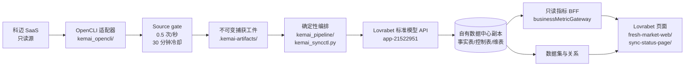

# Fresh Market 当前架构

**版本**：architecture-2026-11-14  
**范围**：科迈只读采集、Lovrabet 副本、同步编排、经营指标和只读页面。

## 1. 架构图

科迈是 source of truth；数据中心是可重建的副本。所有写入动作都止于 Lovrabet，不回写科迈。

## 2. 组件职责

| 层 | 代码/目录 | 职责 | 不负责的事 |
|---|---|---|---|
| 源适配 | `kemai_opencli/` | 固定命令、筛选契约、列表/详情读取 | 不提交、审批、导入或删除科迈对象 |
| 源协调 | `kemai_pipeline/source_gate.py`、`kemai_source_gate.py` | 跨进程锁、间隔、冷却、源操作预算 | 不统计页面全部静态请求 |
| 捕获存储 | `kemai_pipeline/artifacts.py`、`.kemai-artifacts/` | capture manifest、分页、摘要、回执和恢复工件 | 不把未完成快照标成完整 |
| 编排 | `kemai_syncctl.py`、`kemai_pipeline/workflow.py`、`operator.py` | plan、执行、恢复、放弃、窗口证据 | 不凭最大日期推断连续覆盖 |
| 数据中心端口 | `kemai_pipeline/lovrabet_adapter.py`、`runner.py` | 标准模型 API 的有界读写、回读、冲突保护 | 不走业务 SQL 写入，不盲目重试未知结果 |
| 控制面 | `acceptance.json`、`capabilities.py`、`state.py` | 流能力、放行白名单、状态和缺口 | 不因适配器存在就宣称验收完成 |
| 业务指标 | `.rabetbase/sql/...`、`businessMetricGateway.js`、`docs/kemai-global-business-metrics-v1.md` | 统一指标、覆盖伴随信息、只读查询 | 不自行改公式或把估算毛利当财务毛利 |
| 展示 | `fresh-market-web/`、`sync-status-page/` | 只读看板、同步状态和业务分析 | 不向科迈发请求或写业务数据 |
| 历史证据 | `docs/legacy/`、`.local-audits/` | 历史迁移、受控核对 | 旧 `legacy/` 代码已删除，仅从 git 历史对照；不得与新写入体系并发 |

## 3. 数据流与一致性

1. OpenCLI 用固定的门店、日期字段和空筛选约束读取源；零售使用上传时间，采购使用制单时间。
2. 每个窗口先形成一个不可变 capture；分页没有完成时不能把另一快照的页拼接进来。
3. 编排层按稳定源键、内容摘要、窗口日期和 batch 序号生成批次；同 ID 不同内容直接拒绝。
4. 数据中心写入通过标准模型 API；业务行、源捕获、批次回执和窗口证据在受控事务中落地，写后必须回读。
5. `sync_pipeline_windows` 的逐日证据用于连续覆盖；`covered_through` 只是展示最大值，不能代表历史连续完整。
6. 指标 BFF 只从自有数据集读取；每个响应带口径版本、数据截至时间、覆盖字段和 warning。

## 4. 并发、速率和失败边界

- 单机 writer lock 保证正式写入者唯一；每条流有事务行锁；多机 fencing 尚未实现。
- 源逻辑操作共享不超过 0.5 次/秒，遇限流统一冷却 1,800 秒；失败请求也占用时间槽。
- 批次硬上限由服务端契约控制（最多 200 行、records JSON 不超过约 64 KB）；编排会按字节预算提前切分。
- 写入超时先查回执和读回，不能直接重放；capture 只允许沿原 ID 恢复。
- 采购详情、零售详情/支付、商品对象和历史收货 Excel 映射有独立能力状态，不能由列表成功推导为完整。

## 5. 数据模型分组

- **交易事实**：`retail_orders`、`retail_sale_flows`、`purchase_documents`、`purchase_receipt_history_lines`。
- **交易子对象**：采购行、分支、审批和详情状态；其覆盖独立记录。
- **商品对象**：`products`、`product_profile`、`product_child_records`。
- **同步控制**：`sync_pipeline_*`、`sync_stream_*`、`source_capture`、`sync_coverage_gaps`。
- **经营域**：让利、会员/人员/付款方式/促销维表及数据集关系；当前部分由交易副本派生，不能当作科迈主数据全量。

DDL 在 `db/`，数据集映射在 `kemai_pipeline/datasets.json`。SQL 文件用于结构和只读计算；业务行写入不通过 SQL。

## 6. 部署形态

当前仓库提供一次性前台执行入口和本地锁/状态目录；没有默认启用的常驻服务、OS 调度或多机租约。`kemai_pipeline_service.py` 可以作为明确授权的一次性/前台进程使用，但启动它不等于已经部署 supervisor。

运行时副本（如 `~/.opencli/clis/kemai/`）必须与仓库源码经过显式检查同步；部署只读适配器不应携带数据库凭据。

## 7. 扩展规则

新增流必须先补齐：源筛选契约、稳定键、捕获/恢复、数据集映射、事务和回读、重复运行、失败/限流测试、真实小窗口证据、`acceptance.json` 评审和操作文档。没有完整证据时保持 `paused` 或未放行，不通过裸 SQL、任意批量接口或旧脚本绕过。
