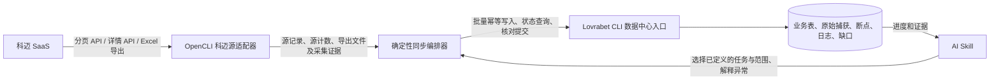

# 科迈到数据中心同步体系：目标架构与迁移顺序

> 2026-11-08 实施更新：公共内核与零售链路已按标准接口实现；验收证据、已启用范围和未完成项见[标准接口交付记录](kemai-standard-api-delivery-2026-11-08.md)，实际命令见[操作指引](kemai-pipeline-operations-2026-11-08.md)。下文历史规划/评审楼层保留，不应当作最新运行状态。

> 2026-11-08 修订版 v2。依据开发计划的 [comment-9](kemai-sync-development-plan-2026-11-08.md#comment-9) C1–C12 与 [comment-10](kemai-sync-development-plan-2026-11-08.md#comment-10) 无保留同意，经用户授权回写。本文定义目标与验收，不表示下文尚未实现的 OpenCLI 命令、Lovrabet BFF 或数据表已经上线。当前能力核对见[现状清单](kemai-sync-capability-map-2026-11-08.md)，具体工作包与排期见[开发计划](kemai-sync-development-plan-2026-11-08.md)，本轮真实源试运行见[交付记录](kemai-sync-delivery-2026-11-08.md)。目前新旧常驻采集都已停止。

## 1. 目标与责任边界



| 层 | 只负责什么 | 不负责什么 |
|---|---|---|
| **OpenCLI 源适配器** | 登录会话、科迈列表/详情/导出任务、响应规范化、源端业务错误与限流识别；提供原始记录和来源证据 | 不连接或写数据中心，不决定哪个历史窗口可以宣称完整 |
| **Lovrabet CLI 数据中心入口** | 查询数据集与状态、运行确定性分析、调用已发布的批量幂等写入/提交能力、回读验证 | 不访问科迈，不根据一条记录猜测源端完整性 |
| **同步编排器** | 按数据类别制订并执行窗口计划，选择分页或 Excel，调用上述两个 CLI，管理预算/互斥/断点/重试与核对 | 不内嵌浏览器抓包、源接口地址、任意 SQL 字符串或未经约束的 AI 写入 |
| **AI Skill** | 理解用户意图，读取能力表和缺口，选择“检查/补历史/跑增量/解释异常”，给出范围与证据 | 不直接改检查点、不跳过核对、不自行放宽限流或把 `partial` 改成 `complete` |

这个分层允许更换科迈接口或数据中心写入实现，而不重写同步策略。编排器只依赖两侧稳定契约；Skill 只依赖编排器的受控命令。

## 2. 当前代码与目标的差距

1. `opencli kemai --help` 目前有 **13 条源读取/导出指令**。商品清单、基本详情和 14 类页签还散落在 Python 的 `opencli browser ... eval` 中；OpenCLI 尚无统一的商品读取契约。Excel 导出指令会在科迈创建或复用任务，虽标为 `read`，仍有源端任务副作用。
2. `kemai_commerce_sync.py` 等脚本同时负责 OpenCLI 调用、规范化、MySQL 批量 upsert、检查点与日志；这能运行，但源端、编排和数据中心写入耦合在一起。
3. `lovrabet data filter/getOne/aggregate` 能做运行态读取与基本分析，`data batchCreate` 只能新增。**DB_TABLE 的 `data import-excel` 没有内建 upsert、导入检查点或 `--resume`**；直接用它替换现有万级行批量 upsert 会破坏幂等恢复。`lovrabet sql exec`/`bff exec` 是可用的调用入口，但本项目尚无经验证的科迈批量幂等写入契约。
4. 零售今天的 `once` 已真实验证，仍是**按整日列表重取的临时快照**；采购/商品没有接入新的半小时轮询。旧日常编排器已暂停。零售原详情/支付和部分采购附属数组、商品初始页签仍有明确缺口。
5. 现有 `sync_checkpoints`、`sync_stream_events/status`、`sync_objects` 与 `sync_coverage_gaps` 保存了核心事实；它们尚未形成“各数据类别、各窗口、各抓取方式”统一可查询的执行计划和精确源请求账本。`source_requests_estimate` 不是精确计数。

## 3. 两侧必须先固定的契约

### 3.1 科迈源适配器契约

每个源命令返回统一元数据：`tenant`、`stream`、`source_window`、`method=page|export|detail`、`schema_version`、`observed_at`、`source_task_id`（若有）、`page/total_pages`、`row_count`、`source_total`（若可信）、`content_hash`、`rate_limit/cooldown` 和无敏感凭证的错误类别。业务行保留原始 JSON；大结果写受控 NDJSON/Excel 工件，由编排器按路径和摘要消费，避免把数万行塞进一条 CLI JSON 输出。签名下载 URL 不落入日志或数据库。

源适配器只做读取与可证明的规范化；它不能自己宣布“历史完整”。分页列表按稳定源 ID 去重；同日活动列表允许记录跨页重叠并标临时，已关闭日期要求独立总数或明确记录“仅单轮计数”。源端 HTTP 200 `code=1` 的“操作太频繁”、HTTP 429 和弹窗统一转为限流信号。

### 3.2 数据中心契约

编排器通过 Lovrabet CLI 调用**已发布且验收过**的数据中心能力，至少需要：

| 操作 | 必须保证 |
|---|---|
| `state.get` | 只读返回 `baseline_from,coverage_scope,verification_method,last_contiguous_verified_day,holes,partial_objects,pending_batches,last_success_at`；列表与详情分别维护覆盖，从已证明基线与逐日证据推导连续日，禁止用 `covered_through` 最大值推导；基线未知返回 unknown。计划由编排器生成 |
| `batch.upsert` | 输入 `tenant,stream,window_key,capture_id,batch_id,payload_hash,source_key_version,records`；稳定源键和批次键幂等，原始捕获、业务行与服务端批次回执同事务，返回新增/更新/跳过/冲突数；超时后能按 `batch_id` 回读结果 |
| `batch.result` | 按批次身份回读服务端持久回执，解决写入后客户端超时的未知结果，不盲目换批次重发 |
| `window.commit` | 服务端验证本次 capture 完整批次清单、完成证据、源/DB唯一数及独立总数（源支持时），原子提交成功事件与相应范围检查点；失败或 partial 不推进该范围完整水位。列表与详情分别判断，附属详情缺口不阻塞后续列表日增量 |
| `window.fail` / `gap.record` | 记录限流、断连、源字段缺失、孤儿关系和未知结果；保留上次成功时间和已提交对象进度 |
| `audit.read` | 通过 Lovrabet CLI 查询业务表、事件、检查点、缺口与批次结果；支持按流/日期/对象回读 |

实现优先使用受控 Backend Function + 标准数据模型 API：批量查询稳定键，新增用 `tx.models.…batchCreate(rows)`，已有变化记录使用标准 `update`；业务行、原始捕获与回执放在同一已验证连接的事务中。`batchCreate` 是批量新增原语，可作为 `batch.upsert` 的内部实现，但单独调用不提供存在则更新、批次回执或重试语义。相同值批量更新使用 `update({id:[...],...fields})`；不同记录不同值不能伪装为此接口支持的批量更新。只有标准 API 无法满足且有实测证据的原子竞争控制、异值更新性能等局部需求才考虑 Custom SQL，不将所有批量新增改写成 SQL。查询后新增仍需数据库唯一约束及冲突处理，事务本身不消除并发竞争。**先验证事务、批量、幂等键、超时回读和权限契约**。

`data_center_client` 定义领域协议，下面挂 `lovrabet_adapter` 与 `legacy_mysql_adapter`。后者仅迁移/回退，不算目标完成；Lovrabet 验证失败可保留旧正式路径、继续内核离线开发，但不切换。旧 SQL/事务分布在多个脚本，需要按批次写入、窗口提交、缺口与审计操作抽取，不能只替换 connect/sql/one。

开始日志和失败日志可独立提交并保留上次成功水位；成功事件与检查点同事务。现有 start_window/finish_failure 自提交而 finish_success 由调用者提交，本身不是事务缺陷。P0-1 用端到端测试验证三类边界与超时回读，不为形式统一修改旧事务。

## 4. 每类数据如何选择分页与 Excel

| 数据类别 | 分页 API | Excel 的角色 | 当前必须保留的限制 |
|---|---|---|---|
| 零售订单、逐商品销售流水 | 保留源 ID 的主采集路径 | 独立 `totalRows` 核对 | 订单 Excel 缺原商品行/支付，流水 Excel 缺稳定内部 ID，**不能直接替代 API 入业务表** |
| 采购订单/收货/退货 | 列表 + 每单详情 | 无已验证的完整详情导出 | 列表 `totalRecord` 已见不可靠；附属数组缺失须记 `partial` |
| 历史已审核收货明细 | 单轮分页或按月导出 | 字段/复合稳定键验证通过后可用于大批首录 | 只覆盖已审核报表行；不能补出原单内部 ID、未审核历史或所有详情 |
| 商品基础档案 | 列表/API 与商品档案导出 | 大批基础字段首录及总量核对候选 | 导出缺 14 类页签；源键/字段对齐验证前不可直接覆盖已有行 |
| 商品详情、14 类页签、零售原详情/支付 | 按对象详情 API | 目前没有等价完整导出 | 用对象级断点与覆盖缺口；空数组是合法结果，缺键与失败须区分 |

选择规则由**版本化能力表**决定，而非仅看行数：先检查导出是否含稳定键、必需字段、可信总数及可复用工件；满足才用 `export_for_data`。字段不完整但有可信 `totalRows` 时用 `api_for_data + export_for_count`。没有可信导出时用 `api_only`，并标明核对等级。大数据量可提高每页到已验证上限并批量落库，但不得凭速度跳过源键、字段与总数核对。

能力表还须保存 `source_key` 字段组合、规范化规则与 `source_key_version`，API/Excel 使用同规范；不一致拒绝静默新增，升级须做映射、迁移与碰撞核对。成本记录为观测样本，带 `observed_at/sample_count/artifact/environment/scope/confidence`；整轮耗时不能视为单页耗时。请求预算是硬上限，ETA 是估算，P0-0 独立提取旧日志后再纳入基线。

## 5. 全量、增量、限流与停机追赶

编排器对每个 `(tenant,stream,source_day or object)` 管理状态：`pending → running → verified/partial/failed/cooling`。`verified` 必须伴随验证方法和证据；`partial` 保留已完成对象，不推进其对应范围的完整水位；列表已核对而附属详情 partial 时，可推进列表日断点，详情缺口独立保留。空日必须关联真实源查询或导出证据，仅写 verified_empty 标签不足以证明空日。窗口运行写入批次键，重复执行先回读已提交批次，安全重试后以源键 upsert，不靠“行数没变”推断无重复。

1. **首次全量**：从每流已确认的最早源日期或商品目录起点分块。先产出只读计划，按能力表选择 Excel 数据首录或 API 单轮分页；每块核对源唯一键、入库键、可用的独立总数与详情覆盖，再提交块检查点。缺字段、不可访问详情和历史空白进缺口台账，不伪装成全量完成。
2. **日常增量**：有可信 `modified_since`/版本游标的流用它；当前仅有日期筛选的流，今天做临时快照、次日 02:00 后做日终核对，再按证据安排迟到修改的旧日重核。**整日重取不是严格时间增量**，只能在页面标为 provisional，直到日终核对。
3. **限流**：所有源请求共享单一速率预算（目前最多 0.5 次/秒）和 30 分钟冷却。源端限流时记录当前窗口/批次、冷却截止时间；停止继续发请求，冷却后从数据中心持久断点恢复，不并发加速。精确请求数应在源 gate 每次实际逻辑请求处记账，不能从成功页数倒推。
4. **停机很久后恢复**：只读查询每流最后**连续且已验证**的窗口、窗口洞和未完成对象；从最早未验证位置生成有界追赶计划。先给今天必要的临时快照，再分批补历史积压；每流独立推进，失败不挡其他流。计划显示待补天数/对象数、所需抓取方式、估计请求和预计最短耗时，不能把估算当承诺。运行日志与 DB 断点决定恢复位置，进程 PID/本地 JSON 不作为业务断点。
5. **晚到数据**：即使已完成旧日，也按每流的可变更期限和源字段能力安排低频重核。发现新/变记录 upsert；源列表未见的旧记录只标待核，不能自动删除。若源系统没有修改时间和可靠历史查询，就明确标出无法证明绝对无漏数的范围。

单机首版以共同任务锁保证任务所有权；所有可运行写入入口须参与或被禁止，进程表检查不能防止竞态。源 gate 负责请求串行化、速率与共享冷却，不证明任务唯一。多机启用前引入集中租约，启用后才称其为任务权威；每次批次写入与窗口提交均在同一事务内验证租约代数（fencing），拒绝旧持有者提交，失租后停止新源请求。多机能力不阻塞首条单机验收。

## 6. 面向人的命令与 AI Skill

最终给操作人员一个薄的统一入口，语义直接对应业务目标；它只调用两侧 CLI 和既有确定性模块，不复制抓取逻辑：

```text
kemai-syncctl status
kemai-syncctl history check --scope db --stream retail-sales --from YYYY-MM-DD --to YYYY-MM-DD
kemai-syncctl history fill  --stream purchase-receipts --from YYYY-MM-DD --to YYYY-MM-DD --limit N
kemai-syncctl incremental run --stream retail-orders,retail-sales --until now --budget-requests N
kemai-syncctl gaps show --stream item_tab_barcode
```

以上是**目标命令契约，不是当前已安装命令**。`check --scope db` 默认仅核对本库与已有证据；`--scope source` 会重新请求科迈且可能创建/复用导出任务，但不写业务表。`fill/run` 会在输出明确的数据类别、源窗口、方法、请求预算和预计写入范围内执行；P0-2 冻结版本化 JSON 输出，含 run/window/capture/batch 身份、来源与观测时间、源/DB唯一数、验证方法、覆盖/缺口、持久断点、冷却、错误类别以及实际/估算请求数。AI Skill 先读 `status`/`check`，再决定是否调用 `fill/run`，最后用 Lovrabet CLI 回读核验；用户暂停的类别保持暂停，Skill 不能因“智能”绕过。

## 7. 实施顺序与验收门槛

| 阶段 | 交付 | 通过标准 |
|---|---|---|
| A. 固定契约与只读入口 | 每流能力表、统一源记录/导出工件格式、源端错误分类与测试夹具；优先交付 status/gaps/history check 的本库模式 | 13 条现有命令兼容，首条零售流水契约可离线验证；商品清单/详情/页签按同一契约独立开发，不阻塞 B；无源端真实大批重采 |
| B. 数据中心写入 | 发布 Lovrabet CLI 可调用的 `batch.upsert/window.commit/state.get` 确定性能力 | 用测试表证明重复批次、断连未知结果、父子表事务、并发锁和检查点原子性；与旧 MySQL 结果逐键对账 |
| C. 编排器 | 统一 `status/history check/history fill/incremental run/gaps show` | 断点空洞、停机多日、限流冷却、源分页重叠、Excel 字段缺失都能生成正确计划并恢复；每流互不误推进 |
| D. 平行核验与切换 | 在小日期/小对象窗口并行比较新旧路径的源键、哈希、数量与覆盖级别 | 差异清零或明确入缺口；正式切换时单一写入者，不双写生产业务表 |
| E. AI Skill | 把用户意图映射到受控任务并解释证据 | 能指出“不完整/无可信总数/限流等待”，不会擅自重试未知写入或改写检查点 |

只读入口优先复用 Lovrabet 数据集读取；暂用 legacy MySQL 的版本明确标过渡。P0-1 在验证时间盒内交出通过证据或具体缺口，不承诺平台能力必然通过。商品源命令可独立开发。

目前已验证的 `once`、历史补采和审计脚本是**迁移基线**，不是需要推倒重写的逻辑。先证明 Lovrabet CLI 背后的幂等批量写入契约，再把旧脚本里的数据中心访问逐流替换；不要先把所有 SQL 改成 `data batchCreate`。

## 8. 具体怎么改：按一条流纵向打通，再横向推广

不要一次拆完所有脚本。先以 `retail-sales` 作为纵向样板：它既有高频当日快照、历史日期追赶，也有 Excel 独立总数，现有源 ID、表唯一键、真实源验收和离线测试可作为对照。随后迁移 `retail-orders` 与订单行映射，再迁移采购三类、历史收货、商品基础/详情/页签。每迁移一条流，都保持旧实现可回退，但任一时刻只有**一个正式写入者**。

新内核包命名 `kemai_pipeline/`，避免同名包遮蔽现有 `kemai_sync.py` 及其调用方。

| 工作包 | 主要落点 | 可交付结果与硬门槛 |
|---|---|---|
| 1. 源端抽取 | `kemai_opencli/`、运行时 `~/.opencli/clis/kemai/` | 增商品列表、详情和页签的专用源命令；导出任务“启动→查询→下载/读取”形成统一工件接口；现有 13 命令保持兼容。所有入口走源 gate，HTTP 200 业务限流和 429 同样冷却。先用本地响应夹具测字段、空数组、缺键、重复页。 |
| 2. 数据中心网关 | 新增受控 Backend Function/Custom SQL、对应 DDL 和 `lovrabet` 调用封装 | 先做 `state.get`、`batch.upsert`、`batch.result`、`window.commit`、`audit.read`。用 `lovrabet bff exec` 或经验证的 CLI 入口调用；如果参数体有大小限制，小批 JSON 写入，大批走带批次键的暂存导入和服务端合并。**原始捕获、业务行、批次回执和检查点的事务边界必须明确**。 |
| 3. 纯编排内核 | 新增 `kemai_pipeline/` 包：`capabilities`、`planner`、`runner`、`validator`、`source_client`、`data_center_client` | `planner` 只根据能力表、数据库状态和当前时间生成窗口；`runner` 只调用两端契约；`validator` 给出 `verified/partial/failed` 及证据。内核不得 import `pymysql`、浏览器对象或源 URL。 |
| 4. 统一操作入口 | 新增 `kemai_syncctl.py`，现有各脚本保留作过渡 | 实现 `status`、`history check/fill`、`incremental run`、`gaps show`。`check` 明确区分 db/source 范围；`fill/run` 明示将处理的流、窗口、预算、方式，使用相同的编排内核。已有 `plan/once/start` 保留兼容并逐流委托新内核，避免两套调度语义长期并存。 |
| 5. Skill | 更新 `kemai-opencli`、`kemai-sync` | Skill 只从受控入口挑选动作、解释核对证据和异常；源限流、幂等、事务、暂停状态由代码强制执行。 |

数据中心网关的首个验收不能只看“写入成功”：同一批次提交两次应得到同一回执；写入后连接断开时能凭批次键查到最终结果；父子表任一失败不能留下已前进的检查点；两个执行者争同一窗口只能有一个提交。先在测试表和小窗口证明，再考虑正式流切换。

## 9. 运行协议：状态、工件、批次与恢复

每个任务有 `run_id`，源业务键与采集身份分开：

| 身份 | 定义与恢复规则 |
|---|---|
| `window_key` | 稳定业务范围：tenant + stream + source_range + capture_mode |
| `capture_id` | 一次采集版本；进程恢复复用原 ID，新的当日快照或旧日复访另建 ID |
| `batch_id` | capture_id + 稳定批序号；同批重试复用，不跨 capture 复用旧回执 |
| `payload_hash` | 独立内容校验值；同 batch_id 不同内容报冲突 |

服务端 window.commit 只接受当前 capture 的完整批次清单与完成证据，不能仅信任客户端总数，也不能拼接不同采集版本的页来证明完整。完整工件可从未写批次续写；源捕获未完整且分页 offset 不稳定、无可靠游标时，记录中断并新建 capture 重读，业务表继续按源键幂等。源文件记录摘要、行数、字段版本和观测时间，导出任务 ID 与文件分开记录，敏感下载 URL 不持久化。

建议增补**批次回执表**与**工件元数据表**，复用现有 `sync_stream_events/status`、`sync_checkpoints`、`sync_objects`、`sync_coverage_gaps`，不再造另一套“最后同步时间”。新表的键/索引、保留期限和数据量要先用零售流水样本测算；已存在的生产表不因架构升级重建。

窗口流转为 `planned → fetching → fetched → writing → verifying → verified/partial/failed/cooling`。发生限流、进程退出或 DB 断连时，恢复程序首先用 Lovrabet CLI 查 `batch.result`、最后连续完成窗口和未关闭缺口，再决定重读哪个源窗口。源端读取没有可用工件就重读该窗口；已有完整工件则复用 capture 和原批次身份，只重试未完成写入与核对。`partial` 的已写对象可以保留，但必须有待补详情对象清单和覆盖级别；不得用一次列表总数一致来关闭详情缺口。

“最后成功同步时间”与“已核对到哪个源日期”继续分开显示。时间型游标必须有源端可靠的更新时间或稳定版本依据才启用；目前日期接口按**当日临时快照 + 漏日逐日追赶 + 日终总数核对**运行。停机 10 天就补 10 个源日，不补 480 个半小时触发点；已完成但可能晚到修改的旧日进入独立低频复访队列。复访不能回退正式日检查点，也不能凭源列表暂未见到就删除数据库旧行。

## 10. 上线切换次序与停止条件

1. **离线契约测试。** 用已保存的响应和 Excel 样本做源解析、稳定键、分页重叠、空日、缺数组和限流测试；用模拟 Lovrabet CLI 测批次回执/超时未知结果。此阶段不触发真实源和生产 DB 写入。
2. **数据中心测试表验收。** 验证 BFF/SQL 的事务与容量、CLI 参数体上限、Excel 暂存导入、权限和可回读性。任何一项无法证明，就保留现有 MySQL 批量写入作为正式路径，不宣称目标架构完成。
3. **一条流影子核对。** 对少量已保存的零售流水工件写测试表，逐源键比较旧正式表与新路径的字段、哈希、数量和事件，不双写正式业务表。
4. **单流切换。** 旧调度仍保持暂停；固定一个已核对检查点，启用新 `retail-sales` 写入者并只跑小窗口。核对源唯一数、DB 唯一数、Excel 总数、批次回执、事件、缺口和客户状态，再逐流扩大。回退时停止新执行者，使用同一持久断点和旧幂等写入路径，不改写已经证明的源事实。
5. **启用调度。** 所有需要的流达到对应验收后，才配置 30/60 分钟触发。调度只负责触发；停机追赶、限流等待和任务互斥在编排内核/数据中心状态里决定。若部署多机，先引入跨主机租约及 fencing；当前本机文件锁不能承担这个保证。

交付是否完成，以操作人员能独立执行“查缺口→补指定历史→跑一轮增量→看核对证据→断点恢复”这一闭环为准。**仅新增命令名、定时器或 Skill 文案都不算完成。**

## 11. 共识落点与待验证事项

本修订对应开发计划 comment-9 的 C1–C12：C1/C2 见第 1、3、8 节；C3/C4 见第 3、5 节；C5 见第 9 节；C6/C8 见第 4 节；C7 见第 5、10 节；C9/C10/C11 见第 6–8 节；C12 的范围与暂估见开发计划。首条零售流水验收后再横向扩展，正式业务表始终单写。

旧轮零售 once 与商品 barcode/supply 小样本已有真实源验收记录，纳入回归基线；新架构小窗口尚未验收。Lovrabet 的事务/容量/回执、源成本样本、各类导出稳定键和未来是否多机仍待实施验证。完整范围 22–42 人日与缩减单流 8–14 人日均为暂估，P0-1 后重估；后者明确后置现场重核、Excel 数据首录、多机租约和 Skill，不代表完整体系交付。文档修订不启动常驻采集，也不解除零售详情/支付暂停。
